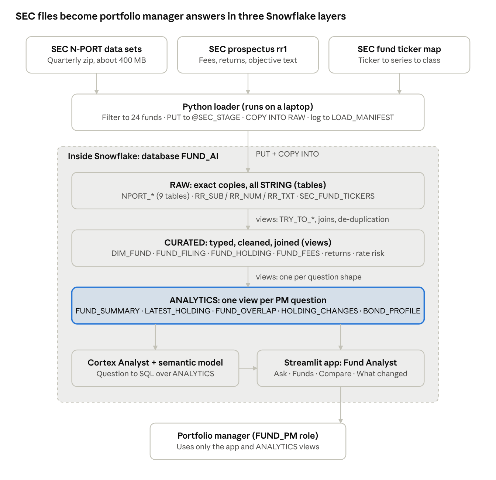
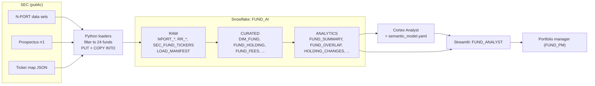
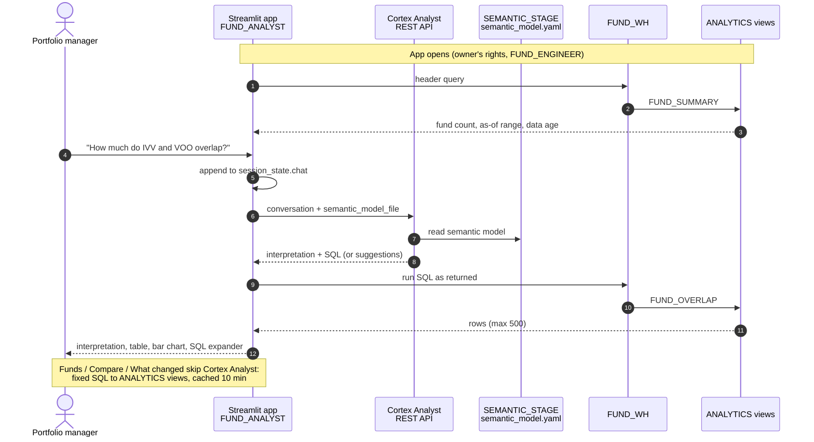

# Fund Analyst on Snowflake: Knowledge Base

Oct 18, 2026 · Source: [Claude Doc](https://claude.ai/code/artifact/319cf56a-1738-4e23-93bc-7b7bbdd8ff46) (this file is an export; the doc is the editable copy)

## Overview: the problem we are solving

A portfolio manager (PM) can ask plain-English questions about 24 public funds and get answers built from SEC filings inside Snowflake, with the SQL and the data's as-of date shown beside every answer.

PMs managing positions need to know what a fund holds, how concentrated it is, how much two funds overlap, what it costs, how sensitive it is to rates and what changed since the last filing. All of this is public, but it sits in SEC quarterly files of about 400 MB each, in raw TSV and XBRL form. Turning it into answers takes an analyst hours per question.

| Item | Scope of this proof of concept |
| --- | --- |
| Users | Portfolio managers (read-only, through an app) and the data engineer who runs it |
| Funds | 24 fund series: IVV, VOO (same series as VFIAX), VTI, QQQM, IWM, VTV, VUG, USMV, VEA, VWO, IEMG, AGG, BND, TLT, LQD, HYG, TIP, XLK, XLF, XLE, XLV, SCHD, ARKK, DODGX |
| Data loaded | SEC N-PORT holdings for 2025 Q3, 2025 Q4 and 2026 Q2; SEC prospectus fees and returns for 2025 Q3 to 2026 Q2 |
| Platform | Snowflake 30-day trial, Enterprise edition, Azure Central India (trial ends around 9 November 2026) |
| Questions answered | Holdings and concentration, fund overlap, costs, bond duration and coupon, monthly and calendar-year returns, position changes between filings |
| Out of scope | Prices, benchmarks, sector classification, real-time data, investment advice |

## Data sources: where the data comes from

All data is free and public from the US SEC. No paid feeds, prices or benchmarks are used.

| Dataset | What it holds | Format and size | Frequency and lag | Loaded |
| --- | --- | --- | --- | --- |
| [SEC Form N-PORT data sets](https://www.sec.gov/data-research/sec-markets-data/form-n-port-data-sets) | Every position a fund holds, with identifiers, bond terms, monthly returns, rate sensitivity (DV01) and fund-level totals | Quarterly zip of about 30 TSV files, 400-450 MB (holdings file 860 MB unzipped) | Funds file monthly; only the quarter-end month is public, about 60 days later | 2025 Q3, 2025 Q4, 2026 Q2 |
| [SEC Mutual Fund Prospectus Risk/Return Summary data sets](https://www.sec.gov/data-research/sec-markets-data/mutual-fund-prospectus-riskreturn-summary-data-sets) | Fees per share class, calendar-year returns, turnover, objective, strategy and risk text | Quarterly zip in XBRL style (sub, num, txt), 25-80 MB | Each fund files roughly once a year, so four quarters cover all funds | 2025 Q3 to 2026 Q2 |
| [SEC fund ticker map](https://www.sec.gov/files/company_tickers_mf.json) | Ticker to fund series to share class | JSON, a few MB | Updated regularly by the SEC | Current at load time |

Rules that shaped the loaders:

- The SEC requires a `User-Agent` header with a contact address on every download.
- SPY and QQQ are unit investment trusts and do not file N-PORT, so IVV and QQQM replaced them.
- One fund series can have several tickers: VOO and VFIAX are two share classes of the Vanguard 500 Index Fund and share one set of holdings.
- Prices (Stooq, Tiingo), macro data (FRED) and factor data (Ken French) were planned but not loaded.

## Data loading, step by step

A Python loader on the engineer's laptop cuts each 400 MB SEC file down to the 24 funds (about 55,000 holdings per quarter) and loads it into Snowflake's RAW layer; views then build CURATED and ANALYTICS on top.

1. **Resolve tickers.** `loader/load_tickers.py` reads the SEC ticker map and keeps every share class of the 24 series (52 classes) in `RAW.SEC_FUND_TICKERS`.
2. **Download.** `loader/load_nport.py --period 2025q4` fetches `2025q4_nport.zip` once and caches it in the git-ignored `data/` folder.
3. **Filter by a key chain.** The loader streams each TSV line by line and keeps only rows for the funds:
   1. `FUND_REPORTED_INFO` by `SERIES_ID` gives the funds' filing ids (`ACCESSION_NUMBER`).
   2. Filing ids select rows in `SUBMISSION`, `REGISTRANT`, `MONTHLY_TOTAL_RETURN`, `INTEREST_RATE_RISK`, `FUND_VAR_INFO` and `FUND_REPORTED_HOLDING`.
   3. Holdings give `HOLDING_ID`s, which select `IDENTIFIERS` and `DEBT_SECURITY`.
4. **Stage.** Filtered files are uploaded with `PUT` to `@FUND_AI.RAW.SEC_STAGE/nport/<period>/`.
5. **Load, re-runnably.** Rows for the period are deleted, then `COPY INTO RAW.NPORT_<table>` loads them with an explicit column list, `METADATA$FILENAME` into `_SOURCE_FILE`, and `FORCE = TRUE`.
6. **Record.** One `RAW.LOAD_MANIFEST` row per table and period: source, period, file, rows, status, time.
7. **Prospectus data.** `loader/load_rr.py` repeats steps 2-6 for the rr1 files: numeric and text facts by series, then the filings they belong to, into `RR_NUM`, `RR_TXT`, `RR_SUB`.
8. **Curate.** SQL migrations V004, V006 and V007 create typed, joined, de-duplicated views in `CURATED`.
9. **Serve.** Migration V008 creates one `ANALYTICS` view per question shape; the app and the semantic model read only these.

| Object | Rows loaded |
| --- | --- |
| `RAW.NPORT_FUND_REPORTED_HOLDING` (3 quarters) | 166,401 |
| `RAW.NPORT_IDENTIFIERS` | 178,096 |
| `RAW.NPORT_DEBT_SECURITY` | 104,373 |
| Fund filings (`NPORT_SUBMISSION`, `NPORT_FUND_REPORTED_INFO`) | 72 each |
| `RAW.RR_NUM` / `RR_TXT` / `RR_SUB` | 1,169 / 2,053 / 20 |
| `CURATED.FUND_RETURN_MONTHLY` | 468 monthly returns |
| `CURATED.FUND_FEES` | 52 share classes |
| `CURATED.FUND_ANNUAL_RETURN` | 380 calendar-year returns |

## Design strategy

Keep everything inside one Snowflake account, in three layers, built from real file headers and checked against known facts, and sized to fit a free trial.

| Principle | How it shows up in this build |
| --- | --- |
| Layered data | RAW is an exact copy (all `STRING` + load metadata); CURATED types, cleans and joins; ANALYTICS has one view per PM question. The app and the AI read only ANALYTICS. |
| Evidence before design | RAW tables were generated from the real headers of the SEC files, not from documentation. |
| Re-runnable everything | Migrations use `IF NOT EXISTS` and `CREATE OR REPLACE VIEW`; loaders delete a period before reloading it. |
| Verify against known truth | Published fees (IVV 0.03%, ARKK 0.75%), near-total overlap of two S&P 500 funds, AGG duration of about 6 years. |
| Free tier first | A trial account cannot call the SEC from inside Snowflake and blocks `CORTEX.COMPLETE`, so loading runs on a laptop and the chat returns tables, not prose. |
| Least privilege | `FUND_PM` can only open the app and read ANALYTICS views; `FUND_ENGINEER` owns objects. Key-pair authentication for automation. |
| Cost in code | One XSMALL warehouse with 60-second auto-suspend and a 100-credit monthly resource monitor, all in Terraform. |
| Freshness visible | Every serving view and answer carries the as-of date (portfolio date) and the filing date (when it became public). |
| Small and boring | Views instead of pipelines; one warehouse; plain Python scripts and `assert`-based tests. |

## Architecture decision records (ADRs)

Thirteen decisions shaped the build; three are marked Revisit because a paid account or a newer Snowflake feature would change them.

| ID | Decision | Why (context) | Alternatives considered | Consequences | Status |
| --- | --- | --- | --- | --- | --- |
| ADR-01 | Snowflake is the one platform for data, AI and the app | One security boundary for storage, compute, AI and UI; a trial was available | Separate database, BI tool and external LLM API | One bill and one role model; tied to Snowflake features and trial limits | Accepted |
| ADR-02 | Use only free public SEC data | Zero budget; SEC filings are the authoritative source | Paid fund data, paid Marketplace listings | Data is 2-8 months old; no prices, benchmarks or sectors | Accepted |
| ADR-03 | 24-fund universe, filtered before loading | Each quarter's file is about 400 MB; trial credits are limited | Load the whole market | Fast, cheap loads; changing the universe needs a reload | Accepted |
| ADR-04 | Loader runs on a laptop with `PUT` and `COPY INTO` | Trial accounts cannot use external access integrations | Snowpipe, or a Snowflake task calling the SEC | Refresh is manual; move it inside Snowflake on a paid account | Revisit |
| ADR-05 | RAW is all `STRING`; typing happens in CURATED | SEC columns drift between quarters | Typed RAW tables, schema inference | Loads never fail on types; `TRY_TO_*` in views | Accepted |
| ADR-06 | Views, not Dynamic Tables | About 170,000 rows that change quarterly | Dynamic Tables, dbt | No refresh cost; AI-generated queries over stacked views take 5-8 s | Revisit |
| ADR-07 | Terraform for account objects; SQL migrations for database objects | Infrastructure must be reviewable as a plan | Everything in SQL, or everything in Terraform | Provider pinned `~> 2.0`; state is local; migrations not yet tracked by a runner | Accepted |
| ADR-08 | Key-pair authentication for all automation | No passwords in scripts, chat or logs | Password, OAuth | The private key stays on the engineer's machine; the public key is registered once | Accepted |
| ADR-09 | Cortex Analyst with a YAML semantic model on a stage | Accurate SQL needs units, synonyms and verified queries; Analyst works on the trial | Free-form LLM text-to-SQL; semantic views | Chat returns SQL and tables; semantic views are now Snowflake's recommended format | Revisit |
| ADR-10 | Streamlit in Snowflake for the UI | Runs inside the account with the owner's rights; nothing to host | External web app, BI dashboard | Pinned to the Streamlit 1.35 runtime; an open session keeps the warehouse running | Accepted |
| ADR-11 | Security key = CUSIP, else ISIN, else issuer name and title; placeholders count as missing | CUSIP `N/A` on 30,955 rows merged 10,363 issuers into one key | CUSIP only | Correct overlap and concentration; a regression test guards it | Accepted |
| ADR-12 | Position changes are measured against the fund's median share-count change | Index funds' share counts all move with creations and redemptions | Raw balance change | Index funds show real trading, not fund flows | Accepted |
| ADR-13 | Duration = absolute total DV01 / (net assets x 1 bp) | Vanguard reports DV01 as negative, iShares as positive | Signed DV01 | Comparable durations; HYG still reads below its published figure | Accepted |

## Why these components

Every component is the simplest Snowflake-native or standard tool that does its job on a free trial.

| Component | Role here | Why it was chosen | What it replaced or avoided |
| --- | --- | --- | --- |
| Snowflake Enterprise trial | Storage, compute, security, AI and app hosting | Everything in one account; Enterprise features such as access history | Running separate database, BI and AI services |
| `FUND_WH` (XSMALL) + `FUND_RM` monitor | Runs every query; caps spend at 100 credits a month | Smallest size handled all queries with no queueing and no remote spill | Larger or multiple warehouses |
| Internal stage `SEC_STAGE` + `COPY INTO` | Bulk load of filtered files | Standard, fast, records the source file per row | Row-by-row inserts; external stages |
| Python loaders (`snowflake-connector-python`) | Download, filter, upload and load | Streams 860 MB files line by line on a laptop; works on a trial | Snowpipe or tasks, which need external access |
| `LOAD_MANIFEST` table | Audit of every load by table and period | Cheap way to replay and reconcile | No load history |
| Terraform (`snowflakedb/snowflake` provider) | Warehouse, monitor, database, schemas, roles, grants (23 resources) | Reviewable `plan` before `apply`; future grants in code | Clicking objects in the console |
| SQL migrations V001-V009 + `scripts/migrate.py` | RAW tables, stages, CURATED and ANALYTICS views | Idempotent DDL, versioned files | Hand-run scripts |
| CURATED and ANALYTICS views | Typing, joins, de-duplication, PM-shaped answers | Small data, always current, no refresh cost | Dynamic Tables, dbt (kept for later) |
| Cortex Analyst + `semantic_model.yaml` | Turns a question into SQL over ANALYTICS | Units, synonyms and 4 verified queries make answers accurate; available on the trial | `CORTEX.COMPLETE` (blocked on trial), external LLMs |
| Streamlit in Snowflake (`FUND_ANALYST`) | The PM's chat and dashboards | Runs inside the account; viewers need only usage on the app | External web app with its own login |
| Python `assert` test scripts | Data, analytics and chat checks | Fail loudly; caught 4 real bugs before users saw them | No tests |
| Claude skills (data and platform engineering) | Reviews, audits, readiness checks | Repeatable standards and 60 read-only SQL checks | Ad-hoc reviews |

## Data flow and lineage

Data moves one way: three SEC sources, a filtering loader, then RAW, CURATED and ANALYTICS inside Snowflake; the app and Cortex Analyst read only ANALYTICS.

The Funds, Compare and What changed tabs query ANALYTICS views directly; the Ask tab sends the question to Cortex Analyst with the semantic model, and the app runs the SQL it returns.

| ANALYTICS view | Built from (CURATED) | Traces back to (RAW) |
| --- | --- | --- |
| `FUND_SUMMARY` | `LATEST_FILING`, `LATEST_HOLDING`, `DIM_FUND`, `FUND_FEES`, `FUND_TURNOVER`, `FUND_ANNUAL_RETURN` | N-PORT filings and holdings, `RR_NUM`, `RR_SUB`, `SEC_FUND_TICKERS` |
| `LATEST_FILING` | `FUND_FILING`, `DIM_FUND` | `NPORT_FUND_REPORTED_INFO`, `NPORT_SUBMISSION`, `NPORT_REGISTRANT` |
| `LATEST_HOLDING` | `FUND_HOLDING`, `DIM_ASSET_CATEGORY`, `DIM_ISSUER_TYPE` | `NPORT_FUND_REPORTED_HOLDING`, `NPORT_IDENTIFIERS`, `NPORT_DEBT_SECURITY` |
| `FUND_OVERLAP` | via `LATEST_HOLDING` (security key) | as `LATEST_HOLDING` |
| `HOLDING_CHANGES` | `FUND_POSITION` (from `FUND_HOLDING`), `DIM_FUND` | N-PORT holdings, two most recent filings per fund |
| `BOND_PROFILE` | `LATEST_HOLDING`, `FUND_RATE_RISK` | N-PORT holdings and `NPORT_INTEREST_RATE_RISK` |
| `FUND_ASSET_MIX`, `FUND_COUNTRY_MIX` | via `LATEST_HOLDING` | N-PORT holdings |
| `FUND_CLASS_COST` | `FUND_FEES`, `DIM_FUND`, `FUND_SUMMARY` | `RR_NUM`, `RR_SUB`, `SEC_FUND_TICKERS` |
| `ANNUAL_RETURNS` | `FUND_ANNUAL_RETURN` | `RR_NUM`, `RR_SUB` |
| `MONTHLY_RETURNS` | `FUND_RETURN_MONTHLY` | `NPORT_MONTHLY_TOTAL_RETURN` |

Every RAW row carries `_SOURCE_FILE` (the staged file it came from) and `_LOADED_AT`; Snowflake's access history, recorded on this Enterprise account, can confirm which columns each query read.

## Streamlit output: what the portfolio manager sees

The Fund Analyst app (`FUND_AI.APP.FUND_ANALYST`) opens with a freshness header and four tabs; every answer shows its data and, in the chat, the SQL behind it.

**Header:** funds covered (24), portfolio data as of 2026-02-28 to 2026-04-30, average age of holdings in days, a note that holdings are public about 60 days after the portfolio date, and a disclaimer that this is analysis of public filings, not investment advice.

| Tab | What the PM does | What the app shows | Reads |
| --- | --- | --- | --- |
| Ask | Types a question in plain English, or clicks one of 6 starter questions; follow-ups keep context | Cortex Analyst's interpretation, a result table (up to 500 rows), a bar chart for label-plus-number results, and the SQL in an expander | Semantic model over ANALYTICS |
| Funds | Filters by fund type, then picks a fund | All funds with net assets, as-of date, positions, top-10 %, expense %, turnover, last full-year return; for one fund: top 15 holdings, asset mix, top 10 countries, calendar-year returns, and for bond funds duration, coupon, maturity and treasury / corporate / securitized split | `FUND_SUMMARY`, `LATEST_HOLDING`, mixes, `ANNUAL_RETURNS`, `BOND_PROFILE` |
| Compare | Picks two or more funds | Key metrics side by side, an overlap heatmap (100 = identical holdings), the largest positions across the chosen funds | `FUND_SUMMARY`, `FUND_OVERLAP`, `LATEST_HOLDING` |
| What changed | Picks a fund | Previous and current snapshot dates, the fund-wide share-count move, counts of NEW / SOLD / INCREASED / DECREASED / UNCHANGED, and the positions with the largest weight changes | `HOLDING_CHANGES` |

Answers from the chat test battery (10 of 10 correct against live data):

| Question | Answer from the app |
| --- | --- |
| Which fund has the highest net assets? | VTI, about $1.99 trillion (as of 2026-03-31) |
| How much do IVV and VOO overlap? | 96.8%, 476 shared securities |
| What is the expense ratio of VFIAX? | 0.04% |
| Which bond fund has the longest duration? | TLT, 15.6 years |
| Which funds hold NVIDIA? | 11 funds; XLK holds the most at 15.5% |
| What percent of QQQM is in its top 10 holdings? | 49.2% |
| What is the average coupon of LQD? | 4.57% |
| What did ARKK buy or sell recently? | 54 changes, led by a new 2.85% position in CoreWeave |

On the trial account the chat returns tables and SQL, not written summaries, because `CORTEX.COMPLETE` is blocked; Cortex Analyst itself works.

## Streamlit app: how it runs

The app is two files on a stage plus one `STREAMLIT` object; Snowflake runs the Python, and every answer is plain SQL on `FUND_WH` against ANALYTICS views.

**Deploy (engineer, after any change to `app/`)**

1. `python scripts/deploy_app.py --account <ORG-ACCOUNT> --user <USER>` connects as `FUND_ENGINEER` with the key pair.
2. `PUT` uploads `app/semantic_model.yaml` to `@FUND_AI.APP.SEMANTIC_STAGE`, and `app/streamlit_app.py` + `app/environment.yml` to `@FUND_AI.APP.STREAMLIT_STAGE/fund_ai`.
3. `ALTER STAGE ... REFRESH` updates each stage's directory table, so Snowsight's file pickers (including the Cortex Analyst editor) see the new files.
4. `CREATE OR REPLACE STREAMLIT FUND_AI.APP.FUND_ANALYST` points the app at the stage folder, with `MAIN_FILE = 'streamlit_app.py'` and `QUERY_WAREHOUSE = FUND_WH`.
5. `FUND_PM` gets `USAGE` on the app through the Terraform future grant; nothing else to run.

A YAML-only change takes effect on the next question (the app reads the stage file each call); a Python change takes effect when the app is next opened.

**Open (PM or engineer)**

1. Snowsight → **Projects → Streamlit → Fund Analyst**, with role `FUND_PM` or `FUND_ENGINEER`.
2. Snowflake starts the app with the packages in `environment.yml` (Streamlit 1.35, Altair); the first load takes 20-40 s.
3. `get_session()` picks up the active Snowpark session. The app runs with the **owner's rights** (`FUND_ENGINEER`), not the viewer's role.
4. The header query reads `FUND_SUMMARY` for fund count, as-of range and average data age.
5. The tabs render. Funds, Compare and What changed run fixed SQL against ANALYTICS views; results are cached for 10 minutes.

**Ask a question (one chat turn), e.g. "How much do IVV and VOO overlap?"**

| # | Where | What happens |
| --- | --- | --- |
| 1 | Browser | The PM types a question or clicks a starter button; Streamlit reruns the script top to bottom. |
| 2 | App (`streamlit_app.py:129`) | The question is appended to `st.session_state.chat`, the conversation memory for this browser tab. |
| 3 | App (`:130-135`) | The whole conversation (questions plus Analyst's earlier replies) is rebuilt as messages, so follow-ups like "and for QQQM?" keep context. |
| 4 | App (`:55-58`) | `call_analyst` POSTs to `/api/v2/cortex/analyst/message` via `_snowflake.send_snow_api_request`, with the history and `@FUND_AI.APP.SEMANTIC_STAGE/semantic_model.yaml`. No password or token handling inside Snowflake. |
| 5 | Cortex Analyst | Reads the YAML, maps "overlap" to `FUND_OVERLAP` and the tickers to its columns, reuses a verified query if one fits, and an LLM writes the SQL. It does not run the SQL or see the data. |
| 6 | Cortex Analyst → app | Returns up to three parts: **text** (its interpretation), **sql**, and **suggestions** ("did you mean") when the question is too vague. |
| 7 | App (`:147`) | Runs the SQL as returned (not wrapped in a subquery) on `FUND_WH` and keeps at most 500 rows. |
| 8 | Snowflake | The ANALYTICS view computes the answer: `FUND_OVERLAP` sums the smaller weight of each shared security, giving 96.8%. |
| 9 | App (`:111-125`) | Shows the interpretation, the table, a bar chart for label-plus-number results, and the SQL in a "SQL used" expander. |
| 10 | App (`:152`) | Any failure (Analyst error, bad SQL, timeout) is shown as a short message instead of a stack trace. |

Close the tab when done: an open session keeps `FUND_WH` awake; it suspends 60 s after the last query. Chat SQL runs with the owner's rights, which is why a read-only, `SELECT`-only role is an open item before sharing the app.

| Cost item | When it is billed |
| --- | --- |
| Cortex Analyst | Each chat question (about 0.067 credits measured) |
| `FUND_WH` (XSMALL) | While queries run and the app is open; auto-suspends 60 s after the last query |
| Funds / Compare / What changed | Warehouse time only; repeated views within 10 minutes come from the cache |

## Limitations, issues fixed and open items

The answers are correct for the data loaded, but the data is months old, the account is a trial, and the app is not yet safe to share with other users.

**Known limitations**

- Holdings are 2-8 months old; each fund has its own as-of date.
- No prices, benchmarks or sector classification, so no daily returns, relative performance or sector mix.
- ARKK, QQQM and SCHD have no calendar-year returns in the prospectus data; their monthly returns exist.
- HYG's duration from N-PORT (1.4 years) is below the fund's published figure (about 3).
- An open app session keeps the warehouse running; app sessions were about 90% of warehouse run time.
- Cortex cross-region inference is set to `ANY_REGION`, so AI requests may be processed outside Azure Central India.
- The trial ends around 9 November 2026.

**Bugs found by tests and fixed (10-11 October 2026)**

| Symptom | Cause | Fix |
| --- | --- | --- |
| Equity funds summed to about 200% of net assets | Several identifier rows per holding multiplied the join | Collapse identifiers to one row per holding before joining |
| VWO's top 10 looked like 99.7% of the fund | CUSIP `N/A` merged 10,363 issuers into one key | Treat `N/A` as missing; fall back to ISIN, then name |
| BND showed a negative duration | Vanguard reports DV01 as negative | Use the absolute total DV01 |
| Index funds looked heavily traded | Share counts move with creations and redemptions | Compare each position with the fund's median change |
| The letter "s" vanished from prospectus text | A regex backslash was swallowed | Use `[[:space:]]` instead of `\s` |
| Chat answers failed with a syntax error | Generated SQL ends with a comment and was wrapped in a subquery | Run it as returned; limit rows afterwards |
| Monthly returns view would not compile | Correlated `UNION ALL` in a lateral join | `LATERAL FLATTEN` |

**Open items**

- [ ] Run chat SQL under a read-only role and allow only `SELECT` statements (before sharing the app)
- [ ] Put this project under git
- [ ] Grant `FUND_ENGINEER` and `FUND_PM` to `SYSADMIN`; move `FUND_AI` ownership off `ACCOUNTADMIN`
- [ ] Track migrations with a runner that records history
- [ ] Reconcile loaded row counts automatically and count skipped lines
- [ ] Wrap delete-then-load in a transaction
- [ ] Close the account-security items from the platform readiness checks (tracked locally)
- [ ] Answer the 4 open platform blueprint decisions (residency, identity provider, environments, approvers)

## How to run and operate

The app runs in Snowsight today; refreshing data and changing infrastructure are done from the engineer's laptop with the scripts in the `snowflake-ai-ready-data` repo.

**Use the app (portfolio manager or engineer)**

1. Sign in at app.snowflake.com to your account.
2. Pick role `FUND_ENGINEER` (or `FUND_PM` for a PM).
3. Open **Projects → Streamlit → Fund Analyst**; the first load takes 20-40 s.
4. Close the tab when done so the warehouse can suspend.

**Give a PM access:** create their user in **Admin → Users & Roles** with MFA (the admin sets the password), then `GRANT ROLE FUND_PM TO USER <pm_user>;`. Fix the read-only chat item first.

**One-time setup (engineer)**

1. Install Terraform and Python 3.12; generate a key pair and register the public key on your user (`scripts/bootstrap.ps1` prints the statement).
2. `./scripts/bootstrap.ps1 -Org <ORG> -Account <ACCOUNT> -User <USER> -Apply` creates the warehouse, monitor, database, schemas, roles and grants.
3. `python scripts/migrate.py --account <ORG-ACCOUNT> --user <USER>` creates stages, RAW tables and all views.

**Refresh data (each new quarter)**

1. `python loader/load_tickers.py --account <ORG-ACCOUNT> --user <USER>`
2. `python loader/load_nport.py --period 2026q3 --account <ORG-ACCOUNT> --user <USER>`
3. `python loader/load_rr.py --periods 2026q3 --account <ORG-ACCOUNT> --user <USER>`
4. Run the checks: `tests/check_curated.py`, `tests/check_analytics.py`, `tests/ask_analyst.py` (same arguments).

**Deploy app or semantic model changes:** `python scripts/deploy_app.py --account <ORG-ACCOUNT> --user <USER>`.

**Check platform readiness:** run the 60 read-only checks from the `snowflake-platform-engineering` skill (`checks/*.sql` then `checks/99-scorecard.sql`, in one session); results are kept locally, not in git.

Further reading in the repo: `README.md`, `docs/CODEBASE_GUIDE.md` (how the code fits together) and `docs/platform-blueprint.md` (draft platform decisions, local only). Reusable skills: [github.com/ramanathanapa/snowflake-skills](https://github.com/ramanathanapa/snowflake-skills).
